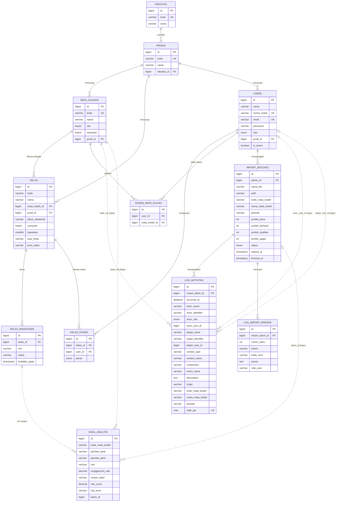

# Desain Basis Data dan Panduan Membaca ERD

Dokumen ini menjelaskan isi database `db_analytic` apa adanya, lalu menunjukkan
cara mengubahnya menjadi ERD yang bisa dipertanggungjawabkan saat presentasi.

- Database: MySQL 8.4, nama `db_analytic`
- Sumber kebenaran: `laravel/database/migrations/` dan `laravel/app/Models/`
- Snapshot isi data: 31 Oktober 2026
- 20 tabel total: 12 tabel domain + 8 tabel infrastruktur Laravel

> Catatan penting: mahasiswa **bukan** pengguna sistem. Tidak ada akun, email,
> atau password mahasiswa. Identitas mahasiswa hanya berupa NIM dan nama pada
> tabel `kelas_mahasiswa`. Ini keputusan desain, bukan data yang belum lengkap.

---

## 1. Cara memahami database ini

Bacalah dari yang paling umum ke yang paling rinci. Jangan mulai dari daftar
kolom, karena akan tenggelam di detail.

### Langkah 1: Kelompokkan tabel berdasarkan fungsi

Jangan menghafal 20 tabel sekaligus. Bagi menjadi lima kelompok:

| Kelompok | Tabel | Pertanyaan yang dijawab |
|---|---|---|
| Master akademik | `fakultas`, `prodis`, `mata_kuliahs`, `kelas` | Kuliah apa yang dibuka, di prodi mana, tahun berapa? |
| Akun dan akses | `users`, `kelas_dosen`, `dosen_mata_kuliah` | Siapa yang boleh masuk dan melihat kelas apa? |
| Mahasiswa | `kelas_mahasiswa` | Siapa saja mahasiswa di sebuah kelas? |
| Import dan log | `import_batches`, `log_aktivitas`, `log_import_errors` | Dari file mana data ini datang, dan apa isinya? |
| Hasil analitik | `hasil_analitik` | Berapa engagement, klaster, dan risiko tiap mahasiswa? |

Delapan tabel sisanya adalah infrastruktur Laravel dan **tidak perlu masuk ERD
bisnis**: `cache`, `cache_locks`, `jobs`, `job_batches`, `failed_jobs`,
`sessions`, `password_reset_tokens`, `migrations`.

### Langkah 2: Baca kuncinya, bukan seluruh kolom

Untuk setiap tabel, cari tiga hal:

1. **Primary key (PK)**: hampir semuanya `id` bigint auto-increment.
2. **Foreign key (FK)**: kolom yang menunjuk ke `id` tabel lain.
3. **Unique key**: aturan yang mencegah duplikat, sekaligus petunjuk kardinalitas.

Contoh membaca `kelas_dosen`:

- PK: `id`
- FK: `kelas_id` -> `kelas.id`, `user_id` -> `users.id`
- Unique: `(kelas_id, user_id)`

Artinya: satu kelas boleh punya banyak dosen, satu dosen boleh mengampu banyak
kelas, tetapi pasangan yang sama tidak boleh dicatat dua kali. Inilah relasi
**many-to-many** dengan tabel perantara.

### Langkah 3: Tentukan kardinalitas dari aturan, bukan dari isi data

Kardinalitas ditentukan oleh constraint dan aturan bisnis, bukan oleh kebetulan
isi tabel saat ini.

| Pola constraint | Kardinalitas |
|---|---|
| FK biasa tanpa unique | 1 : N (satu induk, banyak anak) |
| FK dengan `unique` | 1 : 1 |
| Tabel perantara dengan `unique` gabungan | N : M |
| FK `nullable` | 0..1 : N (induk boleh tidak ada) |

Contoh: `users.prodi_id` boleh `NULL`. Berarti seorang pengguna **mungkin**
tidak punya prodi. Di ERD, sisi `users` ditulis `0..1`, bukan `1`.

### Langkah 4: Baru lihat isinya

Setelah paham bentuknya, periksa apakah data nyata sesuai dengan rancangan.
Gunakan query di bagian 12. Dari isi data kita bisa menemukan hal seperti:

- kelas lama yang kosong,
- mahasiswa yang belum masuk kelompok kelas asal,
- akun demo yang ditugaskan ke terlalu banyak kelas.

Temuan seperti ini adalah **catatan kualitas data**, bukan alasan mengubah ERD.

### Langkah 5: Cocokkan migration, model, dan database

Tiga sumber ini harus bercerita hal yang sama:

| Sumber | Gunanya |
|---|---|
| `database/migrations/` | Bentuk fisik: kolom, tipe, index, FK, aturan hapus |
| `app/Models/` | Nama relasi dan makna bisnisnya |
| Database langsung | Kondisi nyata, termasuk data dan index yang sudah terbentuk |

Kalau berbeda, migration adalah sumber utama untuk bentuk tabel, sedangkan model
menjelaskan cara aplikasi memakainya.

### Tiga tingkat ERD

| Tingkat | Isi | Dipakai untuk |
|---|---|---|
| Konseptual | Entitas dan relasi saja, tanpa kolom | Menjelaskan ide ke dosen/penguji |
| Logis | Entitas, atribut penting, PK/FK, kardinalitas | ERD yang biasanya diminta |
| Fisik | Nama tabel/kolom asli, tipe data, index, aturan hapus | Implementasi dan validasi database |

Untuk proyek ini, buat **ERD logis** sebagai gambar utama, lalu tambahkan
catatan fisik (tipe data dan FK) pada tabel kamus data.

---

## 2. Peta tabel

```
MASTER AKADEMIK
fakultas 1 --- N prodis 1 --- N mata_kuliahs 1 --- N kelas
                    |                                   |
                    +--- N users                        +--- N kelas_mahasiswa
                    +--- N kelas                        +--- N kelas_dosen

AKUN DAN AKSES
users N --- M kelas          (lewat kelas_dosen, ada peran pengampu/pembantu)
users N --- M mata_kuliahs   (lewat dosen_mata_kuliah, izin lihat)

IMPORT DAN LOG
users 1 --- N import_batches 1 --- N log_aktivitas
                              1 --- N log_import_errors

HASIL ANALITIK
import_batches 1 --- N hasil_analitik   (relasi logis, tanpa FK)
mata_kuliahs  1 --- N hasil_analitik   (lewat kode_mata_kuliah, tanpa FK)
mahasiswa     1 --- N hasil_analitik   (lewat nim, tanpa FK)
```

---

## 3. ERD fisik (sesuai database)

Diagram berikut memakai nama tabel asli. Relasi garis penuh adalah foreign key
yang benar-benar ditegakkan MySQL. Garis putus-putus adalah relasi logis yang
hanya dijaga oleh kode aplikasi.



### Cara membaca notasi

- `||--o{` berarti **tepat satu** di kiri, **nol atau banyak** di kanan.
- `|o..o{` berarti relasi logis: **nol atau satu** di kiri, **nol atau banyak**
  di kanan, tetapi tidak ada foreign key di database.
- `PK` = primary key, `FK` = foreign key, `UK` = unique key.

### Mengapa `KELAS_MAHASISWA` bukan `MAHASISWA`

Di ERD fisik, tidak ada tabel `mahasiswa`. Yang ada adalah tabel perantara
`kelas_mahasiswa` yang menyimpan `nim` dan `nama` langsung.

Kalau dosen meminta ERD **konseptual**, Anda boleh menambahkan entitas logis
`MAHASISWA` dengan `nim` sebagai primary key alami, lalu:

```
MAHASISWA 1 --- N KELAS_MAHASISWA
MAHASISWA 1 --- N HASIL_ANALITIK
```

Tetapi beri catatan tegas: **entitas itu tidak punya tabel sendiri**. NIM yang
sama memang muncul di beberapa kelas (507 baris untuk 260 NIM unik), sehingga
secara konsep ia adalah satu mahasiswa yang terdaftar di beberapa kelas.

---

## 4. Relasi dan kardinalitas

### 4.1 Foreign key yang ditegakkan database

| No | Relasi | Kardinalitas | Aturan hapus | Arti |
|---|---|---|---|---|
| 1 | `fakultas` -> `prodis` | 1 : N, opsional | `SET NULL` | Satu fakultas punya banyak prodi |
| 2 | `prodis` -> `mata_kuliahs` | 1 : N, opsional | `SET NULL` | Satu prodi menaungi banyak mata kuliah |
| 3 | `prodis` -> `kelas` | 1 : N, opsional | `SET NULL` | Satu prodi menaungi banyak kelas |
| 4 | `prodis` -> `users` | 1 : N, opsional | `SET NULL` | Pengguna boleh punya prodi |
| 5 | `mata_kuliahs` -> `kelas` | 1 : N, wajib | `CASCADE` | Satu mata kuliah dibuka di banyak kelas |
| 6 | `kelas` -> `kelas_mahasiswa` | 1 : N, wajib | `CASCADE` | Satu kelas berisi banyak mahasiswa |
| 7 | `kelas` -> `kelas_dosen` | 1 : N, wajib | `CASCADE` | Satu kelas punya banyak baris penugasan dosen |
| 8 | `users` -> `kelas_dosen` | 1 : N, wajib | `CASCADE` | Satu dosen punya banyak penugasan kelas |
| 9 | `users` -> `dosen_mata_kuliah` | 1 : N, wajib | `CASCADE` | Satu dosen punya banyak izin mata kuliah |
| 10 | `mata_kuliahs` -> `dosen_mata_kuliah` | 1 : N, wajib | `CASCADE` | Satu mata kuliah diakses banyak dosen |
| 11 | `users` -> `import_batches` | 1 : N, wajib | `CASCADE` | Satu admin mengunggah banyak file |
| 12 | `import_batches` -> `log_aktivitas` | 1 : N, wajib | `CASCADE` | Satu file menghasilkan banyak baris log |
| 13 | `import_batches` -> `log_import_errors` | 1 : N, wajib | `CASCADE` | Satu file mencatat banyak baris gagal |

### 4.2 Relasi many-to-many

| Relasi | Tabel perantara | Unique | Arti |
|---|---|---|---|
| `users` <-> `kelas` | `kelas_dosen` | `(kelas_id, user_id)` | Dosen mengampu kelas, dengan peran `pengampu` atau `pembantu` |
| `users` <-> `mata_kuliahs` | `dosen_mata_kuliah` | `(user_id, mata_kuliah_id)` | Izin melihat seluruh kelas dalam mata kuliah |
| `kelas` <-> mahasiswa | `kelas_mahasiswa` | `(kelas_id, nim)` | Mahasiswa terdaftar di kelas |

`kelas_dosen` dan `dosen_mata_kuliah` sengaja dipisah:

- `kelas_dosen` menjawab "siapa pengampu kelas ini" dan menyimpan peran.
- `dosen_mata_kuliah` menjawab "mata kuliah apa yang boleh dilihat dosen ini".

Akibatnya, dosen bisa melihat sebuah kelas karena salah satu dari dua alasan:
ditugaskan langsung di `kelas_dosen`, atau diberi izin mata kuliah di
`dosen_mata_kuliah`. Aturan ini diterapkan di `Kelas::scopeUntukPengguna()`.

### 4.3 Relasi logis tanpa foreign key

| Relasi logis | Kolom penghubung | Mengapa tidak ada FK |
|---|---|---|
| `log_aktivitas` -> `users` (pelaku) | `actor_user_id` | Pelaku bisa tidak dikenal atau belum punya akun saat import |
| `log_aktivitas` -> `users` (target) | `target_user_id` | Target sering kosong dan berasal dari file eksternal |
| `log_aktivitas` -> `mata_kuliahs` | `kode_mata_kuliah` | File CSV hanya memuat kode mata kuliah, bukan `id` |
| `import_batches` -> `mata_kuliahs` | `kode_mata_kuliah` | Sama, mengikuti format file sumber |
| `hasil_analitik` -> `import_batches` | `batch_id` | Hasil dihitung layanan Python, bukan insert langsung dari tabel |
| `hasil_analitik` -> `mata_kuliahs` | `kode_mata_kuliah` | Hasil analitik memakai kode, bukan id internal |
| `hasil_analitik` -> mahasiswa | `nim` | Mahasiswa tidak punya tabel induk |

Untuk ERD, gambar relasi ini dengan garis putus-putus dan beri label
"logis (tanpa FK)". Jangan gambar sebagai garis penuh, karena akan memberi
kesan integritas referensial yang sebenarnya tidak ada.

---

## 5. Kamus data ringkas

### `users`

Akun untuk orang yang benar-benar login: Admin, Dosen, Kaprodi.

| Kolom | Tipe | Keterangan |
|---|---|---|
| `id` | bigint unsigned, PK | |
| `nama` | varchar(255) | Nama tampilan |
| `nomor_induk` | varchar(32), unique, nullable | NIP/NIDN; dipakai mencocokkan log |
| `email` | varchar(255), unique | Login |
| `password` | varchar(255) | Hash |
| `role` | enum(`admin`,`dosen`,`kaprodi`) | Tidak ada peran mahasiswa |
| `prodi_id` | bigint, FK -> `prodis.id`, nullable | Admin biasanya `NULL` |
| `is_active` | boolean | Akun nonaktif tidak boleh login |
| `remember_token`, `created_at`, `updated_at` | | Bawaan Laravel |

### `fakultas`

`id` PK, `kode` varchar(16) unique, `nama`.

### `prodis`

`id` PK, `kode` varchar(16) unique, `nama`, `fakultas_id` FK nullable.

### `mata_kuliahs`

`id` PK, `kode` varchar(32) unique, `nama`, `sks` tinyint default 3,
`semester` tinyint nullable, `prodi_id` FK nullable.

### `kelas`

`id` PK, `kode`, `nama`, `mata_kuliah_id` FK wajib, `prodi_id` FK nullable,
`tahun_akademik`, `semester`, `kapasitas` nullable, `asal_kelas` nullable,
`jenis_kelas` nullable.

Unique gabungan: `(mata_kuliah_id, kode, tahun_akademik, semester)`.
Artinya kode kelas boleh sama di mata kuliah atau tahun yang berbeda.

`asal_kelas` berisi A/B/C/D. `jenis_kelas` berisi Pagi/Malam. Keduanya `NULL`
untuk kelas yang tidak punya pengelompokan itu.

### `kelas_dosen`

`id` PK, `kelas_id` FK wajib, `user_id` FK wajib,
`peran` enum(`pengampu`,`pembantu`) default `pengampu`.
Unique `(kelas_id, user_id)`.

### `dosen_mata_kuliah`

`id` PK, `user_id` FK wajib, `mata_kuliah_id` FK wajib.
Unique `(user_id, mata_kuliah_id)`.

### `kelas_mahasiswa`

`id` PK, `kelas_id` FK wajib, `nim` varchar(32), `nama` nullable,
`terdaftar_pada` nullable. Unique `(kelas_id, nim)`, index pada `nim`.

Nama boleh `NULL` karena Admin kadang hanya punya daftar NIM. Nama bisa
dilengkapi dari log LMS.

### `import_batches`

Satu baris = satu file CSV yang diunggah.

| Kolom | Keterangan |
|---|---|
| `id` PK | |
| `admin_id` FK -> `users.id` | Pengunggah |
| `nama_file`, `path` | Berkas asli dan lokasinya |
| `kode_mata_kuliah`, `nama_mata_kuliah` | Hasil pembacaan konteks file |
| `periode` | Mis. `2026-02` |
| `jumlah_baris` | Total baris CSV |
| `jumlah_berhasil` | Baris yang masuk ke `log_aktivitas` |
| `jumlah_duplikat` | Baris yang ditolak karena `sidik_jari` sudah ada |
| `jumlah_gagal` | Baris yang tidak valid |
| `jumlah_terkenal`, `jumlah_tak_dikenal` | Statistik pencocokan akun |
| `status` | `menunggu`, `diproses`, `berhasil`, `gagal` |
| `pesan` | Catatan proses |
| `started_at`, `finished_at` | Waktu proses |

### `log_aktivitas`

Satu baris = satu event LMS. Ini tabel terbesar dan paling penting untuk analitik.

| Kolom | Keterangan |
|---|---|
| `id` PK | |
| `import_batch_id` FK wajib | Asal file |
| `occurred_at` | Waktu kejadian, presisi menit |
| `actor_name` | Nama pelaku apa adanya dari CSV |
| `actor_identifier` | NIM/NIP hasil parsing dari nama |
| `actor_role` | `mahasiswa`, `dosen`, `kaprodi`, `akun_lainnya`, `tak_diketahui` |
| `actor_user_id` | Relasi logis ke `users.id`, nullable |
| `target_name`, `target_identifier` | Pihak yang dikenai tindakan, sering kosong |
| `target_user_id` | Relasi logis ke `users.id`, nullable |
| `context_type` | Mis. `Assignment`, `Course`, `Quiz`, `File` |
| `context_name` | Nama konteks, mis. nama mata kuliah |
| `component` | Komponen Moodle, mis. `Logs`, `System` |
| `event_name` | Nama event, mis. `Course viewed` |
| `description`, `origin` | Rincian tambahan |
| `kode_mata_kuliah`, `nama_mata_kuliah` | Konteks mata kuliah |
| `periode` | Bulan analitik, mis. `2026-02` |
| `sidik_jari` | char(32) unique, sidik jari anti-duplikat |

Catatan desain penting:

- Kolom IP **tidak disimpan** karena file sumber sudah rusak saat dibuka Excel.
- Waktu hanya presisi menit; detik tidak dikarang.
- `sidik_jari` adalah hash dari waktu, pelaku, event, dan konteks. Karena unique,
  file yang diunggah dua kali tidak menggandakan baris.
- `actor_role` tidak ditebak dari panjang digit. Peran ditentukan dengan
  mencocokkan `actor_identifier` ke `users.nomor_induk`.

### `log_import_errors`

`id` PK, `import_batch_id` FK wajib, `nomor_baris`, `kolom`, `kode_error`,
`pesan`, `nilai_asal`. Satu baris = satu kesalahan pada satu baris CSV.

### `hasil_analitik`

Satu baris = satu mahasiswa pada satu mata kuliah dan satu rentang periode.

| Kolom | Keterangan |
|---|---|
| `id` PK | |
| `kode_mata_kuliah` | Kode MK, relasi logis |
| `periode_awal`, `periode_akhir` | Format `YYYY-MM` |
| `nim` | Identitas mahasiswa |
| `engagement_rate` | decimal(8,6), 0 sampai 1 |
| `cluster_label` | Mis. `Sangat Aktif`, `Aktif`, `Cukup` |
| `risk_score` | decimal(8,6) |
| `risk_level` | Mis. `low`, `medium`, `high` |
| `batch_id` | Batch sumber, relasi logis |

Unique: `(kode_mata_kuliah, periode_awal, periode_akhir, nim)`.
Artinya satu mahasiswa hanya punya satu hasil per MK per rentang periode.

---

## 6. Alur data

### Dari file CSV sampai dashboard

```
File CSV Moodle
   |
   v
import_batches          satu baris per file, mencatat statistik import
   |
   v
log_aktivitas           satu baris per event, duplikat disaring sidik_jari
   |
   v
Agregasi per NIM + mata kuliah + periode
   |
   v
HTTP POST /analyze      dikirim ke layanan Python (bukan akses MySQL langsung)
   |
   v
hasil_analitik          engagement_rate, cluster_label, risk_score, risk_level
   |
   v
Dashboard Admin / Dosen / Kaprodi
```

Layanan analytics **tidak** terhubung ke MySQL. Laravel mengirim agregat lewat
HTTP, menerima JSON, lalu menyimpan sendiri hasilnya. Karena itu `batch_id` dan
`kode_mata_kuliah` di `hasil_analitik` adalah relasi logis, bukan FK.

### Dari master akademik sampai hak akses

```
fakultas
   |
   v
prodis ---------------------------> users (prodi_id)
   |
   +--> mata_kuliahs --> kelas --> kelas_mahasiswa
   |                       |
   |                       +--> kelas_dosen --> users
   |
   +--> dosen_mata_kuliah --> users
```

Hak akses ditentukan oleh:

1. `users.role`: Admin dan Kaprodi melihat semua kelas; Dosen dibatasi.
2. `kelas_dosen`: dosen ditugaskan pada kelas tertentu.
3. `dosen_mata_kuliah`: dosen diberi izin pada seluruh kelas sebuah MK.

---

## 7. Isi database saat ini

Angka di bawah adalah hitungan langsung, bukan perkiraan `information_schema`.

| Tabel | Jumlah | Keterangan |
|---|---:|---|
| `users` | 22 | 2 admin, 19 dosen, 1 kaprodi |
| `fakultas` | 1 | Fakultas Ilmu Komputer |
| `prodis` | 1 | Teknik Informatika |
| `mata_kuliahs` | 2 | IF207 dan IF209 |
| `kelas` | 20 | 18 kelas berisi + 2 kelas lama kosong |
| `kelas_dosen` | 176 | 168 pengampu, 8 pembantu |
| `dosen_mata_kuliah` | 2 | Dua izin akses mata kuliah |
| `kelas_mahasiswa` | 507 | 260 NIM unik |
| `import_batches` | 2 | Dua file CSV |
| `log_aktivitas` | 131.188 | IF209 92.901, IF207 38.287 |
| `log_import_errors` | 0 | Tidak ada baris gagal tersimpan |
| `hasil_analitik` | 29 | Hanya IF209 |

### Detail import

| Batch | File | MK | Baris CSV | Berhasil | Duplikat | Gagal |
|---|---|---|---:|---:|---:|---:|
| 1 | `datalog-matakuliah-jaringankomputer.csv` | IF209 | 131.767 | 92.901 | 38.866 | 0 |
| 2 | `logdata-matakuliah-Prototipe.csv` | IF207 | 52.491 | 38.287 | 14.204 | 0 |

Jumlah berhasil kedua batch sama dengan isi `log_aktivitas`:
`92.901 + 38.287 = 131.188`.

### Sebaran log

- Rentang waktu: Februari 2026 sampai Oktober 2026.
- Periode terpadat: Mei 2026 (32.551 baris).
- Pelaku: mahasiswa 129.167, kaprodi 1.198, dosen 473, tak diketahui 350.
- Event terbanyak: `Course module viewed` (37.865), `Course viewed` (35.484),
  `The status of the submission has been viewed.` (20.919).

### Hasil analitik

- Hanya tersedia untuk IF209, periode `2026-02` sampai `2026-07`.
- 29 mahasiswa: 11 `Sangat Aktif`, 11 `Aktif`, 7 `Cukup`.
- Risiko: 21 `low`, 2 `medium`, 6 `high`.

### Catatan kualitas data

Catatan ini berguna saat presentasi, tetapi **bukan bagian dari skema**:

1. Kelas `id` 1 dan 2 bernama "Kelas A" dan tidak punya mahasiswa. Ini kelas lama
   sebelum daftar mahasiswa dipecah menjadi A/B/C/D dan Pagi/Malam.
2. Kelas "Tanpa Kelas Asal" (`id` 12 dan 21) berisi mahasiswa yang belum
   dikelompokkan: 6 dan 11 orang.
3. Akun `Dosen Pengampu` (`id` 2) dan `Penjaminan Mutu` (`id` 22) tercatat
   mengampu 16 kelas. Ini jejak data demo, bukan pola pengampuan normal.
4. Satu NIM bisa muncul di beberapa kelas. Itu wajar karena `kelas_mahasiswa`
   adalah relasi banyak-ke-banyak, bukan tabel identitas tunggal.
5. Semua NIM di `hasil_analitik` (29) sudah ada di `kelas_mahasiswa`.

---

## 8. Cara menggambar ERD langkah demi langkah

### Langkah 1: Pilih tingkat ERD

Gunakan ERD logis. Tujuan utamanya menjelaskan hubungan, bukan menampilkan
seluruh 20 tabel. Tabel infrastruktur Laravel tidak perlu digambar.

### Langkah 2: Susun posisi entitas

Letakkan dari kiri ke kanan sesuai alur data:

```
Master akademik        Akun dan akses        Transaksi              Hasil
fakultas               users                 import_batches         hasil_analitik
  prodis               kelas_dosen           log_aktivitas
    mata_kuliahs       dosen_mata_kuliah     log_import_errors
      kelas
        kelas_mahasiswa
```

### Langkah 3: Gambar kunci dan garis

1. Tulis PK di baris pertama setiap entitas.
2. Tulis FK dan arah panahnya.
3. Gunakan kaki gagak (`o{`) di sisi banyak.
4. Gunakan garis putus-putus untuk relasi logis tanpa FK.
5. Beri label verba pada garis: "memiliki", "menaungi", "berisi", "mengampu".

### Langkah 4: Periksa apakah setiap garis masuk akal

- Apakah setiap FK menunjuk ke PK yang tipenya sama?
- Apakah tabel perantara punya unique gabungan?
- Apakah kolom nullable digambar sebagai `0..1`?
- Apakah ada relasi yang hanya ada di kode, bukan di database?
- Apakah `users` dipakai untuk mahasiswa? Jika ya, itu salah.

### Langkah 5: Pilih alat

| Alat | Cara pakai |
|---|---|
| dbdiagram.io | Tempel DBML di bagian 9 |
| Mermaid Live Editor | Tempel blok Mermaid di bagian 3 |
| draw.io / diagrams.net | Pilih bentuk "Entity Relation" |
| MySQL Workbench | Menu Database > Reverse Engineer |

---

## 9. DBML untuk dbdiagram.io

Tempel kode berikut ke <https://dbdiagram.io> untuk mendapatkan ERD yang bisa
digeser dan diekspor menjadi PNG/PDF.

```dbml
Table fakultas {
  id bigint [pk, increment]
  kode varchar(16) [unique, not null]
  nama varchar(255) [not null]
  created_at timestamp
  updated_at timestamp
}

Table prodis {
  id bigint [pk, increment]
  kode varchar(16) [unique, not null]
  nama varchar(255) [not null]
  fakultas_id bigint [ref: > fakultas.id]
  created_at timestamp
  updated_at timestamp
}

Table mata_kuliahs {
  id bigint [pk, increment]
  kode varchar(32) [unique, not null]
  nama varchar(255) [not null]
  sks tinyint [not null, default: 3]
  semester tinyint
  prodi_id bigint [ref: > prodis.id]
  created_at timestamp
  updated_at timestamp
}

Table kelas {
  id bigint [pk, increment]
  kode varchar(32) [not null]
  nama varchar(255) [not null]
  mata_kuliah_id bigint [not null, ref: > mata_kuliahs.id]
  prodi_id bigint [ref: > prodis.id]
  tahun_akademik varchar(16) [not null]
  semester tinyint [not null]
  kapasitas smallint
  asal_kelas varchar(32)
  jenis_kelas varchar(16)
  created_at timestamp
  updated_at timestamp

  indexes {
    (mata_kuliah_id, kode, tahun_akademik, semester) [unique]
  }
}

Table users {
  id bigint [pk, increment]
  nama varchar(255) [not null]
  nomor_induk varchar(32) [unique]
  email varchar(255) [unique, not null]
  email_verified_at timestamp
  password varchar(255) [not null]
  role enum('admin', 'dosen', 'kaprodi') [not null, default: 'dosen']
  prodi_id bigint [ref: > prodis.id]
  is_active boolean [not null, default: true]
  remember_token varchar(100)
  created_at timestamp
  updated_at timestamp
}

Table kelas_dosen {
  id bigint [pk, increment]
  kelas_id bigint [not null, ref: > kelas.id]
  user_id bigint [not null, ref: > users.id]
  peran enum('pengampu', 'pembantu') [not null, default: 'pengampu']
  created_at timestamp
  updated_at timestamp

  indexes {
    (kelas_id, user_id) [unique]
  }
}

Table dosen_mata_kuliah {
  id bigint [pk, increment]
  user_id bigint [not null, ref: > users.id]
  mata_kuliah_id bigint [not null, ref: > mata_kuliahs.id]
  created_at timestamp
  updated_at timestamp

  indexes {
    (user_id, mata_kuliah_id) [unique]
  }
}

Table kelas_mahasiswa {
  id bigint [pk, increment]
  kelas_id bigint [not null, ref: > kelas.id]
  nim varchar(32) [not null]
  nama varchar(255)
  terdaftar_pada timestamp
  created_at timestamp
  updated_at timestamp

  indexes {
    (kelas_id, nim) [unique]
    nim
  }
}

Table import_batches {
  id bigint [pk, increment]
  admin_id bigint [not null, ref: > users.id]
  nama_file varchar(255) [not null]
  path varchar(255)
  kode_mata_kuliah varchar(32)
  nama_mata_kuliah varchar(255)
  periode varchar(16)
  jumlah_baris int [not null, default: 0]
  jumlah_berhasil int [not null, default: 0]
  jumlah_duplikat int [not null, default: 0]
  jumlah_gagal int [not null, default: 0]
  jumlah_terkenal int [not null, default: 0]
  jumlah_tak_dikenal int [not null, default: 0]
  status enum('menunggu', 'diproses', 'berhasil', 'gagal') [not null, default: 'menunggu']
  pesan text
  started_at timestamp
  finished_at timestamp
  created_at timestamp
  updated_at timestamp
}

Table log_aktivitas {
  id bigint [pk, increment]
  import_batch_id bigint [not null, ref: > import_batches.id]
  occurred_at datetime [not null]
  actor_name varchar(255) [not null]
  actor_identifier varchar(32)
  actor_role enum('mahasiswa', 'dosen', 'kaprodi', 'akun_lainnya', 'tak_diketahui') [not null, default: 'tak_diketahui']
  actor_user_id bigint
  target_name varchar(255)
  target_identifier varchar(32)
  target_user_id bigint
  context_type varchar(64)
  context_name varchar(255)
  component varchar(64)
  event_name varchar(255) [not null]
  description text
  origin varchar(32)
  kode_mata_kuliah varchar(32)
  nama_mata_kuliah varchar(255)
  periode varchar(16)
  sidik_jari char(32) [unique, not null]
  created_at timestamp
  updated_at timestamp

  indexes {
    (actor_identifier, occurred_at)
    (actor_user_id, occurred_at)
    (kode_mata_kuliah, occurred_at)
  }
}

Table log_import_errors {
  id bigint [pk, increment]
  import_batch_id bigint [not null, ref: > import_batches.id]
  nomor_baris int
  kolom varchar(64)
  kode_error varchar(64)
  pesan text [not null]
  nilai_asal varchar(255)
  created_at timestamp
  updated_at timestamp
}

Table hasil_analitik {
  id bigint [pk, increment]
  kode_mata_kuliah varchar(32) [not null]
  periode_awal varchar(7) [not null]
  periode_akhir varchar(7) [not null]
  nim varchar(32) [not null]
  engagement_rate decimal(8, 6)
  cluster_label varchar(255)
  risk_score decimal(8, 6)
  risk_level varchar(16)
  batch_id bigint [not null]
  created_at timestamp
  updated_at timestamp

  indexes {
    (kode_mata_kuliah, periode_awal, periode_akhir, nim) [unique]
  }
}
```

Relasi logis berikut sengaja **tidak** ditulis sebagai `ref` di DBML karena
tidak ada FK di database. Jelaskan secara lisan atau sebagai catatan:

```
log_aktivitas.actor_user_id   -> users.id            (logis)
log_aktivitas.target_user_id  -> users.id            (logis)
log_aktivitas.kode_mata_kuliah -> mata_kuliahs.kode  (logis)
hasil_analitik.batch_id       -> import_batches.id   (logis)
hasil_analitik.kode_mata_kuliah -> mata_kuliahs.kode (logis)
hasil_analitik.nim            -> kelas_mahasiswa.nim (logis)
```

---

## 10. Script menjelaskan ERD saat presentasi

Gunakan urutan ini. Setiap poin cukup satu atau dua kalimat.

1. **Masalah utama.** Sistem ini menjawab satu pertanyaan: mahasiswa mana yang
   berisiko, dan mengapa. Karena itu datanya dibagi menjadi tiga lapis: master
   akademik, log aktivitas, dan hasil analitik.
2. **Master akademik.** Fakultas memiliki prodi. Prodi menaungi mata kuliah dan
   kelas. Satu mata kuliah bisa dibuka di banyak kelas, dan satu kelas berisi
   banyak mahasiswa.
3. **Akun dan akses.** Tabel `users` hanya untuk Admin, Dosen, dan Kaprodi.
   Mahasiswa tidak punya akun. Dosen dihubungkan ke kelas lewat `kelas_dosen`,
   dan ke mata kuliah lewat `dosen_mata_kuliah`.
4. **Mahasiswa.** Identitas mahasiswa disimpan di `kelas_mahasiswa` sebagai NIM
   dan nama. Karena satu mahasiswa bisa ada di beberapa kelas, pasangan
   `(kelas_id, nim)` dibuat unik.
5. **Import.** Setiap file CSV dicatat di `import_batches`. Setelah diproses,
   barisnya masuk ke `log_aktivitas`. Duplikat dicegah dengan `sidik_jari` yang
   unik. Baris yang gagal dicatat di `log_import_errors`.
6. **Analitik.** Log diagregasi per mahasiswa, mata kuliah, dan periode, lalu
   dihitung oleh layanan Python. Hasilnya disimpan di `hasil_analitik`:
   engagement, klaster, skor risiko, dan level risiko.
7. **Relasi logis.** Beberapa relasi tidak memakai FK karena data berasal dari
   file eksternal dan layanan analitik terpisah. Relasi itu digambar putus-putus:
   `actor_user_id`, `target_user_id`, `kode_mata_kuliah`, `batch_id`, dan `nim`.

Kalimat penutup yang aman:

> Jadi ERD ini memisahkan data master, data transaksi log, dan data hasil olahan.
> Kunci utamanya adalah NIM dan kode mata kuliah, karena mahasiswa tidak punya
> akun dan log berasal dari LMS, bukan dari input langsung ke sistem.

---

## 11. Checklist sebelum ERD dikumpulkan

- [ ] Hanya 12 tabel domain yang digambar; tabel cache/jobs/session tidak.
- [ ] `users` diberi label "Admin, Dosen, Kaprodi", bukan "semua pengguna".
- [ ] `kelas_mahasiswa` digambar sebagai relasi kelas ke mahasiswa, bukan ke `users`.
- [ ] `kelas_dosen` dan `dosen_mata_kuliah` digambar sebagai dua relasi berbeda.
- [ ] Garis putus-putus dipakai untuk relasi tanpa FK.
- [ ] Setiap FK menunjuk ke PK dengan tipe yang sama (`bigint unsigned`).
- [ ] Kolom nullable digambar sebagai `0..1` di sisi induk.
- [ ] Unique gabungan ditulis di catatan tabel perantara.
- [ ] Ada keterangan bahwa `hasil_analitik` adalah snapshot per periode.
- [ ] Ada keterangan bahwa `log_aktivitas` tidak menyimpan IP dan hanya presisi menit.

---

## 12. Query verifikasi

Jalankan dari Laragon, atau ganti path `mysql.exe` sesuai instalasi.

```sql
-- Daftar tabel
SHOW TABLES;

-- Bentuk satu tabel
SHOW CREATE TABLE kelas;

-- Semua foreign key
SELECT TABLE_NAME, CONSTRAINT_NAME, COLUMN_NAME,
       REFERENCED_TABLE_NAME, REFERENCED_COLUMN_NAME
FROM information_schema.KEY_COLUMN_USAGE
WHERE TABLE_SCHEMA = 'db_analytic'
  AND REFERENCED_TABLE_NAME IS NOT NULL
ORDER BY TABLE_NAME;

-- Semua kolom dan tipenya
SELECT TABLE_NAME, COLUMN_NAME, COLUMN_TYPE,
       IS_NULLABLE, COLUMN_KEY, COLUMN_DEFAULT
FROM information_schema.COLUMNS
WHERE TABLE_SCHEMA = 'db_analytic'
ORDER BY TABLE_NAME, ORDINAL_POSITION;

-- Jumlah baris nyata
SELECT 'users' AS tabel, COUNT(*) AS jumlah FROM users
UNION ALL SELECT 'kelas', COUNT(*) FROM kelas
UNION ALL SELECT 'kelas_mahasiswa', COUNT(*) FROM kelas_mahasiswa
UNION ALL SELECT 'log_aktivitas', COUNT(*) FROM log_aktivitas
UNION ALL SELECT 'hasil_analitik', COUNT(*) FROM hasil_analitik;

-- Cek konsistensi import
SELECT SUM(jumlah_baris) AS total_csv,
       SUM(jumlah_berhasil) AS total_berhasil,
       SUM(jumlah_duplikat) AS total_duplikat,
       SUM(jumlah_gagal) AS total_gagal
FROM import_batches;
```

Perintah Laravel yang membantu:

```sh
cd laravel
php artisan db:table users
php artisan db:table log_aktivitas
php artisan tinker
```

Di dalam Tinker:

```php
App\Models\Kelas::with('mataKuliah', 'dosen', 'mahasiswa')->first();
App\Models\User::where('role', 'dosen')->with('kelasDiampu', 'mataKuliahAkses')->get();
App\Models\LogAktivitas::latest('occurred_at')->first();
```
